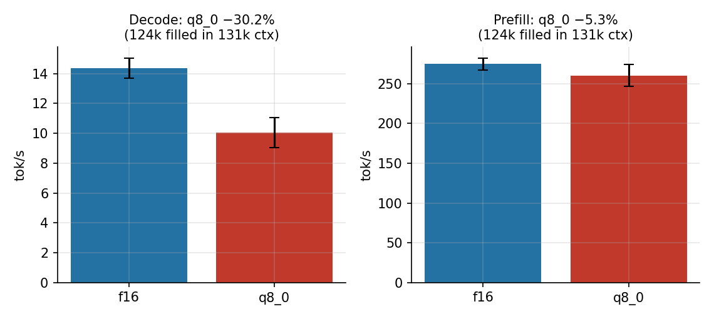

# Muse Glimmer 30B on Strix Halo: a week of measurements

The only published benchmark I could find for Muse Spark's Glimmer 30B on a Ryzen AI Max+ 395, as of October 24, 2026, is [AMD's](https://www.amd.com/en/blogs/2026/run-meta-muse-glimmer-30b-on-amd-ryzen-ai-max-and-radeon-gpus.html): up to 24 tok/s decode, on Windows, on Vulkan, with DFlash speculative decoding, on a preliminary build of the model. I run this model in production, as the local agent seat of a home AI platform, on Linux, on ROCm, on two Strix Halo machines. Over the week of October 18–24, 2026 I benchmarked it: a tuning pass, a context-depth sweep, three controlled maintenance windows on the second machine covering backend comparisons, serving shape, KV cache types at full 131k depth, a quant ladder, power and thermals, and a first vision pass. This article is the results, with the methodology and the caveats kept in, because the caveats are half of what's useful here.

## The setup

The model is `unsloth/Muse-Glimmer-30B-GGUF`. The files, with the SHA-256 hashes the benches verified:

| file | size | SHA-256 |
|---|---|---|
| Muse-Glimmer-30B-UD-Q4_K_XL.gguf | 15.88 GB | `82bece304887a313ece08400bc030f6066c7bff5b906b0cd40308ec8a409fd38` |
| dflash-kquant.gguf (drafter) | 1.63 GB | `27d9a805fa29b943cfb6ad4843367cd4eaaaf06bd452d8cc3e00a2cd18a677bc` |
| mmproj-kquant.gguf (vision) | 1.40 GB | `f48b452316f9b213758e8659444029b961a24a07f99a1abb2a9f88b06f7c00c6` |
| Muse-Glimmer-30B-UD-Q5_K_XL.gguf (ladder) | 21.79 GB | `97a66c4b41d9e778af7cdfa43508e08dbf765fb5049b740c69ad815e5191c637` |
| Muse-Glimmer-30B-UD-Q6_K_XL.gguf (ladder) | 26.27 GB | `fb5f80d110c4fa932cc652e70873c0bd12c0954009038aa675e65086104c2739` |

The drafter matters: DFlash drafts in 16-token blocks, which makes `--spec-draft-n-max 15` the largest useful setting, a detail that turns out to matter twice below.

Both machines are GMKtec EVO-X2 units (Ryzen AI Max+ 395, Radeon 8060S, gfx1151): Crucible with a 48 GiB GPU budget, Furnace with 64 GiB. The build is llama.cpp b11719 (commit `5aeac37a3`) on ROCm 7.2.1, kernel 6.19.10. Production serving runs through llama-swap; the benches did not — they ran llama-bench and scratch llama-server instances against the same build while llama-swap was stopped. The three Furnace windows and the Crucible sweep ran with the GPU exclusive; the one exception is the founding October 18 Forge-path bench, which ran in production posture with a second model co-resident, and its numbers are labelled as production-path observations where they appear. Repetitions: 3 per cell in the llama-bench phases, 2 runs per cell in the tuning pass and the Phase 3 serving cells; means are reported with their dispersion. Where a number comes from a weaker construction, the text says so at the number, not in a footnote.

## Lesson one: the right draft length depends on what the model is doing

The published DFlash guidance for this model family puts the sweet spot at a draft of 3–4 tokens. For open prose that reproduced on Crucible, with one qualification: prose decode's best cell was 19.1 tok/s at n-max 3 (f16 KV, ubatch 256), inside the tuning bench's own noise band (between-cell differences under ~1.5 tok/s are within its dispersion, and the winning cell also changed KV type and ubatch relative to the deployed cell), with n-max 4 cells at 18.4–18.6. Draft acceptance on essays collapses toward 0.11 at long blocks. The tuning bench's shapes, for scale: a 93-token prose prompt with 512 tokens out, and one agent prompt (a backlog-triage ask with three tool definitions), 2 runs per cell, temperature 0.

Agent turns invert it, on that one agent prompt shape. A tool-calling turn is mostly predictable scaffolding (the tool calls are a fixed, predictable format), so acceptance stays at 0.64–0.74 even at the longest blocks, and agent decode runs 60–78 tok/s at n-max 15–16 (73–78 at n-max 15 alone) against roughly 27 at n-max 4. Cold agent-turn wall time: 4.1–4.6 s at n-max 15–16 versus 10.2 s with speculation off. DFlash overall is worth about 1.4× on prose and about 2.3× on agent-turn wall time. One cross-check keeps the category honest: in window 1's story-generation sweep on HIP, a different prose shape, the n-max 15 mean (39.13 tok/s) beat n-max 3 (29.64) outright. "Prose" is not a stable workload category for draft sizing; the split below is per workload shape, measured, not a law.

Two corollaries worth writing down. First, the configuration this model shipped with in my stack used n-max 16; with a 16-token draft block, 15 was the largest useful setting identified, and it reproduced the same agent numbers (16 added no measured benefit). Second, there is no universal "speculative decoding setting" for a dual-purpose seat. My production ends up split: the agent seat runs n-max 15, the prose seat runs n-max 3, same weights, same drafter. On the shapes measured here, that split had the largest effect of any tuning decision in the program.

## Depth: decode is flat, prefill pays

The Crucible depth sweep (llama-bench, no drafter, f16 KV) shows decode essentially indifferent to context depth endpoint-to-endpoint: 13.84 tok/s at depth 0, 13.02 at 65,536, about 6% down across the whole range, consistent with this model's small KV footprint — with a non-monotonic dip at 32k (12.15 ± 1.03) in between, visible in the chart. Prefill is where depth bills you: pp512 falls 36% (457 → 292 tok/s) and pp8192 falls 29% (394 → 278) from depth 0 to 65,536. With the drafter attached on the server path, prose decode at depth runs 16.4 tok/s at depth 0 and 19.5 at 65,536 — measured on filler-established depth with prompt caching on, from a scratch server at ctx 131,072 and one slot rather than the production seat's 65,536 and two, so read those two numbers as a server-path indication, not a like-for-like extension of the sweep.

The operational consequence showed up in the very first bench, a production-path observation rather than a controlled cell: one ~15.9k-token prompt took 49.7 s of wall time including a 60-token answer, with a second model co-resident, which puts prefill in the 300–350 tok/s band the controlled sweeps later confirmed. A cold agent turn carrying a 16k-token system prompt costs on the order of 50 seconds for the turn. Prompt caching is the mitigation (measured below at 99.6–99.7% hit rates after the first turn, on one constructed conversation), not flags.

## HIP versus Vulkan, and an honest loose end

AMD's number is a Vulkan number, so window 1 of the Furnace program ran the canonical llama-bench cells on both the HIP and Vulkan builds of the same llama.cpp commit. One methodological honesty note up front: the comparison is between two local build trees of that commit, not a surgically isolated backend variable; build configuration and driver paths ride along, and the cells were not interleaved. Prefill favors HIP in mean at pp512 at every depth (by 2.5–23%; the 16k cell's HIP dispersion is wide, ±59.87). At pp8192 the picture mixes: Vulkan overtakes HIP at 16k depth (287.54 vs 265.31) and matches at 32k. Decode splits the other way at depth: at the canonical settings (ubatch 512), Vulkan tg128 is flat (13.51 → 12.71 tok/s across 0 → 65,536) while HIP tg128 falls off a cliff between 4k and 16k depth, reaching 4.83 tok/s at 65,536, which makes Vulkan 2.6× faster there.

Then the caveat that keeps this from being a clean "use Vulkan" headline: the HIP cliff is ubatch-sensitive. At ubatch 256, HIP holds 11.12 tok/s at 32k depth instead of 6.43, and Vulkan shows no comparable sensitivity. The Crucible sweep's HIP numbers were also flat at nominally the same defaults, on a different build tree of the same commit. I am publishing the cells as measured, with the ubatch interaction named, rather than a backend verdict the data doesn't cleanly support. If you reproduce a HIP decode cliff on gfx1151, check your ubatch before you blame the backend.

## Speculation at depth is bimodal, and greedy is not greedy

Window 1 also ran the DFlash sweep at depth 32,768, and the result is not a number, it's a distribution. DFlash does not collapse at depth on either backend: in two of the three reps at every draft size from n-max 2 up, decode beat every no-draft baseline rep (~10 tok/s), and on the high-acceptance branch at n-max 15, HIP produced two reps at roughly 89 tok/s at 32k depth. But one of the three reps in these cells falls onto a low-acceptance branch (0.09–0.47) and lands in the baseline's own range. A mean across those branches describes no actual run, which is why the bench record keeps the reps separate, and why the claim above is stated per-rep rather than per-mean. One construction caveat: the 32k context was repeated-sentence filler, which likely flatters acceptance; a natural-text replication at depth is still owed, and 89 tok/s should be read as "the high branch exists and is large on this construction," not as a general depth figure.

The related determinism result comes with a covariate, stated plainly. At temperature 0 with a fixed seed, greedy decoding through the speculative configuration produced 3 distinct outputs in 5 runs. The same prompt, seed, and temperature with the draft model removed produced 5 of 5 identical outputs — but the draft-off runs served from a single-slot server while the draft-on runs served from the two-slot agent server, so slot parallelism is an uncontrolled covariate in that comparison. The measured non-reproducibility tracks the speculative configuration; isolating it from the slot difference needs a rerun on one server shape, which is owed. Anyone evaluating a DFlash-served model with exact-match scoring should know the effect exists in this stack either way.

## KV cache at 131k: the deficit lives in decode

The reference point for this test is a figure traced to a secondary summary of a llama.cpp issue on a different model (an R9700 system), where q8_0's deficit reportedly widened from 7% at zero depth to 21% at 131k. Measured here, at a real 123,918-token prompt on HIP with DFlash at n-max 15: q8_0 decode ran 10.03 tok/s against f16's 14.35, a 30.2% deficit (computed from unrounded values), worse than that figure; prefill ran 260.1 against 274.5, a 5.3% deficit, within reach of noise (n=2 per cell). Two scopes on that result: it is stated for the speculative configuration (draft acceptance by KV type was not recorded, so a speculation-mediated share cannot be separated), and the prompt's construction beyond its token count was not recorded. The deficit at depth lives in decode, not prefill. Since Glimmer's KV is small (about 2.1 GB at 131k for f16), there is no capacity reason to quantize it, and the decode numbers remove the performance reason. f16 KV is the right default for this model at depth, under the configuration tested.

At near-zero filled depth the same comparison was a wash (17.7 vs 17.4 tok/s in the tuning pass, on a 93-token prompt under a nominal 64k context size). That is not evidence about filled 64k contexts, which were never measured: the honest statement is that no penalty showed at negligible depth, a large one showed at 124k of real context, and where between it appears is unmeasured.

## The quant ladder: bigger files, slower decode, no measured quality separation

Phase 4 downloaded UD-Q5_K_XL (21.79 GB) and UD-Q6_K_XL (26.27 GB) and ran the core cells (pp512/tg128 at depths 0 and 32,768). Decode at depth 0: Q4 11.65, Q5 6.70 (−42%), Q6 7.30 (−37%) tok/s. At depth 32,768: 12.21 vs 8.29 vs 6.92. On the agent-suite subset (20 tool-call prompts, 5 JSON prompts, the production set), all three quants scored identically: 20/20 valid tool calls and 5/5 JSON at every quant. That suite is a validity smoke test with a ceiling effect; it cannot exclude subtler quality differences in reasoning depth, factuality, or long prose, and I am not claiming it does. What the evidence supports is narrower and still decisive for a serving decision: the larger quants cost a third to just over two-fifths of decode speed in this run, and the program's narrow validity suite found no separation to pay for it. Q4 is preferred on that basis. The run's own disclosures ride along: the ladder table is a supplemental sequential run executed during a backlog sprint (CPU load 4 rising to 13), Q4 had already run repeatedly that night while Q6 had just finished downloading, and the depth-32,768 Q4 figure carries the cross-window variance flagged below. (One anomaly stands as measured: Q5 decoded below Q6 at depth 0 with non-overlapping dispersion, which a pure file-size story would not predict; the expected order restored at depth. Kernel-path differences between quant layouts are a plausible mechanism; none is claimed.)

## Serving shape: slots buy concurrency, not speed

Across the Phase 3 serving matrix (ctx 65,536 and 131,072; 1, 2, and 4 parallel slots; DFlash on; 2 reps per cell), aggregate throughput is conserved at roughly 15–19 tok/s however the slots are sliced — across five of the six cells. The sixth, one slot at ctx 65,536, measured 6.32 tok/s while running inside a CPU load peak from the estate's own CI churn (load 25–33 on 32 threads); the record flags it contaminated and excludes it from the range on that basis, and it is named here rather than silently dropped. Parallel slots buy concurrent turns, not faster ones, replicating the earliest Forge-path observation (~17 tok/s total across 2 slots) on the direct serving path and extending it to 4 slots and both context sizes. For a single-user agent seat, slot count is a concurrency decision, full stop.

Multi-turn prompt caching is the other serving fact worth having, scoped to its construction: in a single 4-turn conversation over one exact ~6.1k-token shared prefix, the three post-cold turns hit the prompt cache (cache_n / (cache_n + prompt_n) from server timings) at 99.7%, 99.6%, 99.7%. With an exact repeated prefix that is close to the construction's expected outcome; it establishes that the mechanism works as advertised, and real-session rates will depend on prefix stability. Combined with the prefill numbers above, the shape of an efficient Glimmer deployment is: keep the agent's context warm and shared where the workload allows it, and don't expect slots or flags to rescue a cold 16k-token prompt.

## The reasoning tax, and the one real failure

Glimmer reasons visibly, and the reasoning is billed to your token budget. The working control is a chat-template kwarg (`reasoning_strength`), not the server flags: `--reasoning off` and `--reasoning-budget` were both measured inert against this model's template in the October 18 control tests (REASONING-CONTROL-VERDICT-2026-10-18.md, shipped with the bench repo), which opens its reasoning channel unconditionally. With the control in place, the tax is monotonic on the one prompt measured (an incident summary, 2 reps per level), for a near-identical-length visible answer (~370–411 chars) at every level: low ≈ 162 completion tokens, medium ≈ 2.3× that, high ≈ 3.6×.

The failure this produces is the result with the largest deployment consequence in the program, stated at its true sample size: a single run of a single payload. A long-form synthesis payload on Crucible (2,507 tokens in, 4,096-token budget, agent-seat flags with no reasoning control) spent its entire budget on reasoning and returned zero content characters. Decode was healthy throughout (26.9 tok/s sustained); the failure is budget allocation, not throughput. The record's own verdict is disjunctive: a workload like this needs a reasoning-controlled seat or a far larger budget. No multiplier is derived from this data, and the obvious candidate does not survive the tax table above (medium reasoning alone consumed ~3.7× the visible answer's tokens on the tax prompt, and the longtext run consumed a 4,096 budget entire), so the rule is the control, not a number: carry the reasoning-strength control on any seat doing long-form work, and where reasoning is uncontrolled, treat any fixed budget as consumable entirely by reasoning. A harness that treats this model like a non-reasoning model can receive empty answers at full price in time.

Structured output, for the record: 20/20 valid tool calls across the suite, and 5/5 raw-parse JSON in the uncached W2 measurement — which changed two variables at once against the October 18 Forge-path result (direct server path, and reasoning-low), so it establishes the joint result only, with no single-cause attribution. Think-block stripping remains the belt-and-braces step for any JSON consumer.

## Power and thermals: a non-story, measured

A 30-minute sustained decode soak on Q4 (1 Hz rocm-smi sampling across the whole window, 6,758 samples; the soak itself is 1,827 of them) averaged 80.0 W of GPU socket-package power and 0.203 tokens per joule at a sustained wall-mean 16.25 tok/s. That mean mixes the same two DFlash acceptance branches seen in window 1 (per-request rates of 10.6–16.4 and 55–85 tok/s), and is reported as the sustained wall figure for this serving shape, not a typical single request. Edge temperature peaked at 66 °C, and no clock decay was observed in this one soak: mean sclk was 1,969 MHz in the first five minutes and 2,209 MHz in the last five, rising as the chassis heat-soaked by about 6.5 °C. The ladder phases the same night peaked higher (118 W), and longer or higher-power runs are unmeasured; the scoped claim is that at ~80 W mean in this shape, nothing thermal moved in the wrong direction over 30 minutes.

## Vision: a first pass

The mmproj had never been wired up in this stack. On the first attempt it loaded (21.0 s), prefilled a 303-token image prompt at 214.9 tok/s, and decoded at 11.14 tok/s. Against a synthetic 480×360 ground-truth image (test image, ground truth, and full response ship with the bench repo), the model described the background, the shapes, and the colors correctly, and the red rectangle's extents approximately right; two misses: the rectangle, flush with the image corner and fully in frame, was described as cropped by it, and the response hit its 512-token cap before the green square's location sentence landed. One image is a smoke test, not a vision benchmark; it's reported as a working starting point with extent and framing judgment as the visible weakness.

## The settings card

For anyone serving this model on Strix Halo with llama.cpp — scoped to these two EVO-X2 units, this build, and the workload shapes measured above:

- Quant: UD-Q4_K_XL. In the ladder run the bigger files were a decode tax, and the program's validity suite found no quality separation to pay for it.
- Drafter: DFlash on. n-max 15 for agent/tool workloads; n-max 3–4 for open prose on the shape measured, knowing another prose shape inverted that ordering. Use 15 rather than 16: the block is 16 tokens and 16 added nothing measured.
- KV: f16 at any depth you care about. q8_0 showed no penalty at negligible filled depth and cost ~30% of decode at 124k of real context under speculative decode; filled depths between are unmeasured.
- Backend: HIP led the pp512 prefill means; pp8192 mixes by depth (Vulkan overtakes at 16k). Investigate Vulkan if deep-context decode dominates, and check ubatch before concluding anything about either — the two backends here were two build trees of one commit, not an isolated variable.
- Sampling: the model card's temp 1.0 / top-p 0.95 / top-k 64 produced 3 distinct outputs in 3 runs at 12.31 tok/s in the W2 check. Temp 0 was reproducible with speculation off and not with it, subject to the slot-parallelism covariate named above.
- Reasoning: control it through the chat template (`reasoning_strength`), not server flags. Where reasoning is uncontrolled, treat any fixed token budget as consumable entirely by reasoning.
- Serving: slots for concurrency, prompt cache for prefill where prefixes are stable, and no expectation that either changes single-stream speed.

## What this article is not claiming

The depth-32k acceptance highs come from a filler construction and need a natural-text replication. The KV cells are n=2, ran under speculative decode, and their prompt's construction beyond its token count was not recorded. The quant quality suite has a ceiling. The vision result is one synthetic image. HIP decode at depth is not one story yet: Crucible's sweep was flat, Furnace cliffed at ubatch 512 in window 1, and the same nominal Q4 cell at depth 32,768 read 6.43 tok/s in window 1 (ubatch 512), 11.12 at ubatch 256, and 12.21 in window 3 — cross-window variance at depth is documented rather than resolved, and single depth-32768 HIP figures should be read with it in mind. The greedy-reproducibility comparison carries a slot-parallelism covariate and is owed a same-server rerun. The Vulkan cells' RADV/Mesa version was not captured in the window manifest. The bench repo ships the raw JSON, the power CSV, the harness scripts, the record files named throughout, and the environment manifests (kernel, ROCm, build commit, GGUF hashes) so anyone with the hardware can check any of it, and I would rather be corrected with data than believed without it.

Nothing measured here contradicts AMD's figure: 24 tok/s on Windows/Vulkan with DFlash sits inside the range the local branches produce, which bracket it depending on workload and acceptance branch. What's different is everything around the peak: what a typical run looks like, what depth does to each backend, and what the model does to your token budget when you aren't watching it. That's the part that wasn't written down anywhere. Now it's measured.
